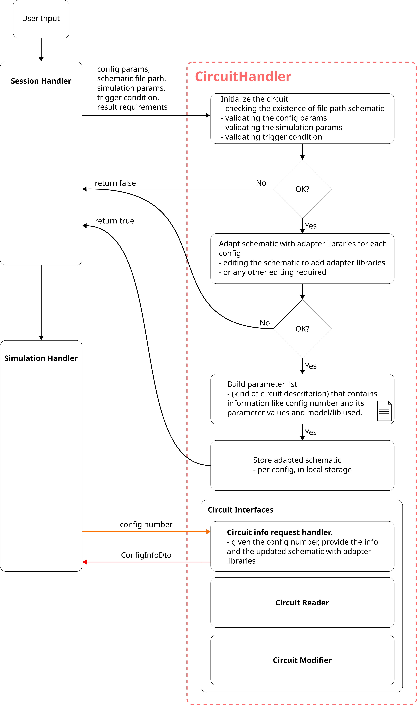

# **CircuitHandler: Software Design Document**

## **CircuitHandler: Software Design Overview**
The CircuitHandler Module manages the verification, validation, initialization of the circuit configurations. It handles the modification of the schematic by including the adapter libraries in the schematic. It takes care of other circuit related functions like review of the circuit information and meta data, detect changeable parameters in a schematic, read net names, etc.

## Description of the CircuitHandler
The CircuitHandler module shall be realized in the form a class. The CircuitHandler program shall take in the circuit schematic path and the configurations of the circuit from the user request via SessionHandler. The validation of all the parameters are done in this program. This will be like the entry point of a software program so that all the inputs are validated at the entry and the other modules do not need to check the parameters again. The CircuitHandler program also has methods for communicating information about the circuits and its configurations to other modules in the pyNgSpiceLab.

## Circuit Information storage
The details of a circuit or its configurations shall be stored in a DTO (Data Transfer Object). This makes it easy to store and pass information for communication. The DTO shall be named as **ConfigInfoDto**. 
Following are the contents of the **ConfigInfoDto**:
- config_number: A unique identifier of the circuit configuration. It shall also be used for naming the results file of the simulation runs.
- config_parameters: A dictionary with a name and key value. The name contains the name of the component in the configuration as string. The key contains the numerical value of that corresponding component along with the units as string.
- config_path: Default string will be the file path to the main circuit schematic. However after the adaptation of the libraries, the string shall be updated to the new adapted schematic for the corresponding configuration.
- library_path: A file path to the available libraries used in the circuit schematic.
- sim_type: The simulation type. Default will be Transient Analysis.
- sim_time_step: The time step for the simulation.
- sim_time: The total simulation time if dynamic stopping is disabled.
- dynamic_stopping: A boolean value to enable or disable the auto stop to simulation based on a trigger condition.
- trigger_condition: A condition that decides the event or time for stopping the simulation.
<!- This list of contents could be extended based on other information we need to be transferred. ->

## Circuit Initialization

The initialization of the circuit goes through different steps before finalizing the circuit configurations. This initialization is triggered by the SessionHandler when the user asks to start the WorkflowProgram.
Following are the steps to initialize a circuit:
- Verification: The circuit schematic file path is verified (Existence check).
- Validation of the circuit schematic: If required this could be developed in order to check the consistency of the given circuit schematic. This could include things like checking if the Title is mentioned, checking if the libraries are included, checking if the components are declared as required and so on.
- Validation of the parameters: The given user parameters are to be checked for consistency and also if these parameters exists in the circuit schematic. 
- Adaptation of the circuit schematic: For every configuration there could be different libraries or models used. These shall be included in the schematic before the simulation begins. Therefore these default circuit schematic shall be modified and updated to include the required libraries. There could be other possible modification which could be applied here as well.
- Storing and updating the data: The adapted schematic needs to be stored in disk. The ConfigInfoDto shall also be updated with the adapted schematic path for respective configurations.

Any errors or missing inputs shall be logged or notified to the user.

## Circuit Interfaces
This sub-section provides functionalities that allows the user to read, modify and access the circuit configuration information.

The circuit configurations information is stored in the ConfigInfoDto. This information shall be available for the other modules of the pyNgSpiceLab if requested. This request is fulfilled by the circuit information API which shares this DTO when given a config_number. If the given configuration is available, the configuration data is returned to the method of the module which requested the data.

### Circuit Reader
These methods allows the program to read the circuit schematic and store the data into ConfigInfoDto. This sub-section works as an extractor which extracts information from a given circuit schematic. The program for the reader will be able to read the whole file and extract the name of the components first name, then the terminals and then the value. However not all components have this format of name, terminals and the value. This procedure needs to updated. The process to read a circuit file shall be mentioned here.

### Circuit Modifier
These methods allows the user to set a component value for all the passive components. It also allows the user to change the model or the library used by a certain component like Transistor.
The process shall be decided as currently we can use the functionality of ngspice to alter the component's values. 

## CircuitHandler SDD Diagram

