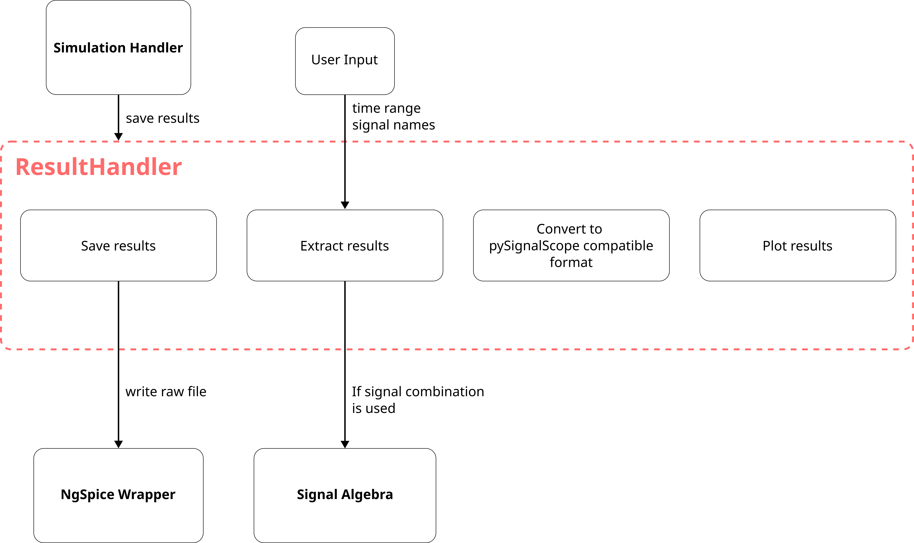

# **ResultHandler: Software Design Document**

## **ResultHandler: Software Design Overview**
The ResultHandler module manages the simulation results related functionalities. It helps user to save, review, analyze and plot the results. The results are stored in the local storage as a raw file. The ResultHandler uses a 3rd party library spicelib to read these raw files easily.

## **Description of the ResultHandler**
The ResultHandler module shall be realized in the form of a class. This module contains APIs that the user or other modules in the pyNgSpiceLab can use. For example, the SessionHandler uses this module to save the results into a raw file after the simulation is finished. Other methods shall fulfill the requirements like extracting a signal from a saved result given a time range and the signal name, plotting the results, converting the plot format to standards of pySignalScope library.
The `ResultHandler` shall be implemented as a class that manages simulation results. The class shall maintain the information required to locate and access the result files associated with completed simulations. The `ResultHandler` shall provide a public interface for saving simulation results, retrieving signal data, and preparing data for visualization. The `ResultHandler` shall be initialized by the `SessionHandler` and made available to the modules that require access to simulation results. The class shall keep result file management, data extraction, and plot data preparation within its own responsibilities.

## **Storage of results**
The ResultHandler shall create and maintain a directory in the local storage that contains all the results. Since the saving of the results will be initialized by the SimulationHandler, the `config_number` is provided to the ResultHandler. This information is used in naming of the raw file for easy identification. 

## **Accessing the results**
The user can access the results by simply calling the API method for reading the raw file. The `RawRead` class from `spicelib` library helps with the reading of the raw files. The user shall provide the signal names and the time range to extract the part in which the user is interested.
The plot method shall take the same input as above from the user and the a graphical image could be generated and saved. If the user prefers to use pySignalScope module, the program also provides method to convert the required results to pySignalScope format. If the user is interested in the signal combination, the ResultHandler module shall make use of the SignalAlgebra support module that helps decompose the combination into base signals which can be further processed.

## **Representation of Results**
The ResultHandler module shall maintain a DTO that shall be used to represent the extracted signals. The following shall be the structure of the DTO:
- SimulationResultDto
    - time: a time array specifying the range of the required time signal (could be represented as numpy array)
    - signals: a dictionary of strings as value and arrays as key. The string represents the name of the signal and array represent the chunk of data for the specified time signal.

## **ResultHandler SDD Diagram**

