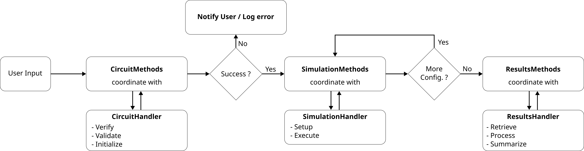
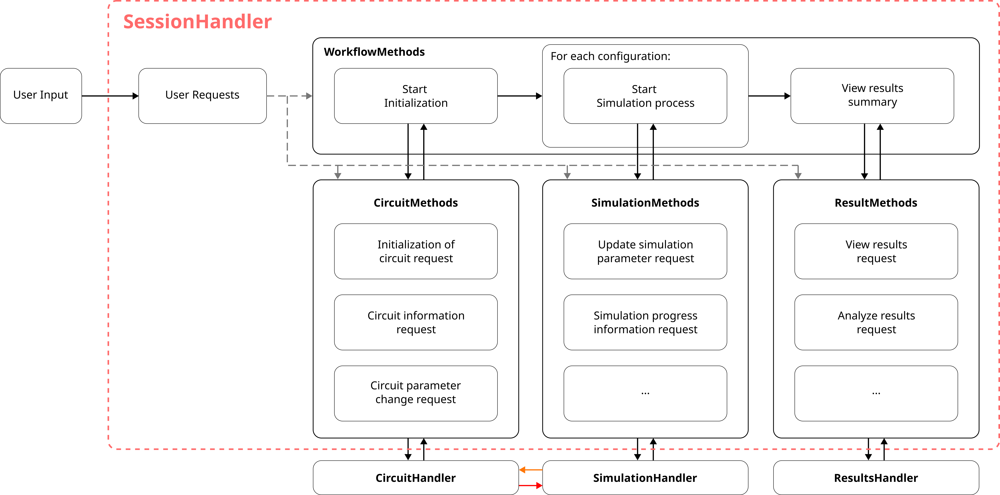

# **SessionHandler: Software Design Document**

## **SessionHandler: Software Design Overview**

The main control program of the pyNgSpiceLab shall control the workflow of the simulations. The user can select different requests among several requests like starting the workflow, requesting circuit information, requesting simulation results data, etc. This program handles all the administrative tasks required and therefore it communicates and coordinates with other modules to execute the requests.

## Description of the main control program

The main control program shall be realized in the form of a class. According to the user's selection of the request, the program shall proceed and perform necessary communications with other modules. The user shall provide the request and the input data required for that request. These requests shall be fulfilled by the APIs available as methods in the SessionHandler class. This class shall contain sub-sections according to the roles they play in the program. The sub-sections are the ProgramWorkflow, CircuitMethods, SimulationMethods, ResultMethods. These sub-sections are interfaces for handling the user requests. They further communicate with the corresponding Handler module for the implementation of these requests.

## User Input Requirements

The user shall select one of the following requests:

- **Start Workflow Request**
- **Circuit Information Request**
- **Access Results Request**

<!-- Additional request types may be added in future development. -->
Each request type has its own set of required inputs, as described below.

For a **Start Workflow Request**, the user shall provide the path to the circuit schematic file, the libraries to be used, and the configuration details, including the parameters to be modified and their corresponding values.

For a **Circuit Information Request**, the user shall provide the path to the circuit schematic file and specify the type of information required, such as configurable parameters, passive components, active components, power sources, or other circuit-related information. If required, the user may also request modifications to the circuit configuration.

For an **Access Results Request**, the user shall provide the configuration number and specify the signals or other result information they want to access, such as a particular signal by name. Results can only be accessed after the corresponding simulation has been successfully completed.

These user requirements shall trigger different sub-sections of the SessionHandler.

The following table summarizes the user input requirements:

| Request Type                    | Required Input                      | Description                                                                                 |
|---------------------------------|-------------------------------------|---------------------------------------------------------------------------------------------|
| **Start Workflow Request**      | Circuit schematic file path         | Path the circuit schematic file to be simulated.                                            |
|                                 | Libraries                           | Libraries or device models to be used for the simulation.                                   |
|                                 | Configuration details               | Parameters to be modified and their corresponding values.                                   | 
| **Circuit Information Request** | Circuit schematic file path         | Path to the circuit schematic file from which information is to be retrieved.               | 
|                                 | Information requested               | Circuit information, such as configurable parameters, components type.                      |
|                                 | Configuration changes *(optional)*  | Requested changes to the circuit configuration, if required.                                | 
| **Access Results Request**      | Configuration number                | Identifies the simulation configuration whose results are to be accessed.                   | 
|                                 | Signal information                  | Specifies the signal(s) or other result information to be retrieved, such as a signal name. |

## Sub-sections of the main control program

### **ProgramWorkflow**
#### Overview
This sub-section is triggered if the user requests to start the workflow of the main control program. The user then shall provide the corresponding inputs.

#### Responsibilities
- Coordinating with other sub-sections in the SessionHandler.
- Simulate circuits and its configurations.
- Keep track of the circuits metadata like configuration number, results status, etc.
- Manage the processing of multiple simulations if requested. (Serial processing or Parallel processing)
<!-- Parallel processing needs to be investigated in detail. -->

### Flow of the Program

The program flow begins by receiving the required inputs from the user and passing them to the **CircuitMethods** sub-section. CircuitMethods coordinates the circuit-related operations by communicating with the **CircuitHandler** module. The CircuitHandler performs the required **verification, validation, and initialization** of the circuit.

If an error occurs during the initialization process, the error is returned to CircuitMethods, which notifies the user and/or logs the error. If the initialization is successful, the program proceeds with setting up the simulations.

The simulation-related data, such as **simulation type, simulation time, time step, dynamic stopping conditions**, and other relevant parameters, is passed to the **SimulationMethods** sub-section for each circuit configuration. **SimulationMethods** coordinates the simulation process by communicating with the **SimulationHandler**, which performs the actual simulation operations.

The program processes the simulations **serially**, coordinating with **SimulationMethods** for each circuit configuration. If an error occurs during a simulation, the error shall be logged and, where applicable, reported to the user. The affected configuration shall be skipped, and the program shall proceed with the next configuration.
This process continues until all circuit configurations have been processed. Once all simulations have been processed, the user shall be notified of the overall simulation status.

Finally, the program communicates with the **ResultsMethods** sub-section to request access to the simulation results. **ResultsMethods** coordinates with the **ResultsHandler**, which performs the actual result retrieval and processing required to provide the simulation results summary.

The following diagram summarizes the flow of the program:

### **CircuitMethods**
#### Overview
This sub-section is triggered if the user requests to get information about the circuit and its configurations. The user then shall provide the corresponding inputs.

#### Responsibilities
- Coordinating with CircuitHandler module in the pyNgSpiceLab.
- Get information about the circuit and its configuration.
- Manage other user requests related to circuit, if any.

### **SimulationMethods**
#### Overview
This sub-section is triggered if the user requests to get information about the simulation and its progress. The user then shall provide the corresponding inputs.

#### Responsibilities
- Coordinating with SimulationHandler module in the pyNgSpiceLab.
- Get information about the simulation and its progress.
- Manage other user requests related to simulation, if any.

### **ResultMethods**
#### Overview
This sub-section is triggered if the user requests to get information about the results. The user then shall provide the corresponding inputs.

#### Responsibilities
- Coordinating with ResultHandler module in the pyNgSpiceLab.
- Get information about the results.
- Manage other user requests related to results, if any.

## SessionHandler SDD Diagram
The following diagram provides the software design document in the form of a diagram.

