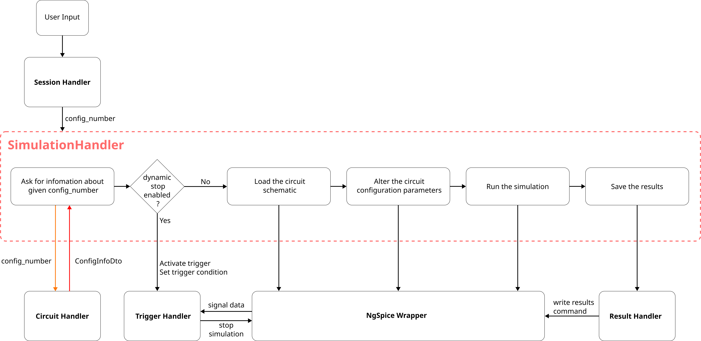

# **SimulationHandler: Software Design Document**

## **SimulationHandler: Software Design Overview**
The SimulationHandler manages the simulation tasks for the circuits and its configurations. It also handles the communication with the ngspice_wrapper library. Via this communication, the SimulationHandler can load the circuit schematic into the ngspice and also help altering the values of the components in the schematic. It also communicates with the CircuitHandler module to ask for the circuit information. For dynamic stopping and saving the results, it communicates with the TriggerHandler and ResultHandler module respectively.

## Description of the SimulationHandler
The SimulationHandler module shall be realized in the form of a class. The simulation functionalities will be triggered by the SessionHandler module. The SimulationHandler then receive only the circuit configuration number from the SessionHandler. Rest of the details of the circuit will be asked from the CircuitHandler. Once the information is received, the SimulationHandler uses ngspice_wrapper to load the circuit schematic into the ngspice. It also handles altering of the values if needed for a configuration. It proceeds to running the simulation based on the simulation parameters in the information provided by the CircuitHandler. If the simulation is successful, the results will be saved in local storage with the help of the ResultHandler.

## Program Workflow

The **SimulationHandler** receives a request to start a simulation for a specific circuit configuration identified by its `config_number`. Since the **SessionHandler** is responsible only for administrative tasks, the SimulationHandler requests the detailed information for the specified configuration from the **CircuitHandler**. The CircuitHandler provides the corresponding **ConfigInfoDto** to the SimulationHandler.

The SimulationHandler then retrieves the simulation-related parameters required for the simulation process. It checks whether **dynamic stopping** is enabled or disabled.

If dynamic stopping is enabled, the SimulationHandler passes the specified `trigger_condition` to the **TriggerHandler** and activates the trigger monitoring process. The TriggerHandler communicates with the ongoing simulation and receives the required signal values to determine whether the specified stopping condition has been satisfied.

If dynamic stopping is disabled, the simulation proceeds without trigger-based monitoring.

The SimulationHandler then loads the circuit configuration into **ngspice** through the `ngspice_wrapper` library. To apply the parameter values specified for the current configuration, the SimulationHandler passes the `config_parameters` to the `ngspice_wrapper`, which applies them using the ngspice `alter` command. This replaces the default component values with the values specified for the current configuration.

The SimulationHandler then constructs the simulation command using the simulation parameters, such as `sim_type`, `sim_time`, and `sim_time_step`. The command is passed to the `ngspice_wrapper` to start the simulation.

The simulation results are collected and saved by the **ResultHandler** as a raw result file in local storage. If the simulation fails or encounters an error, the error shall be logged and, where applicable, reported to the user.

The simulation is executed in **background mode**, using the background simulation functionality provided by ngspice. This allows the Python application and other components of **pyNgSpiceLab** to continue performing other tasks while the simulation is running.

## SimulationHandler SDD Diagram

