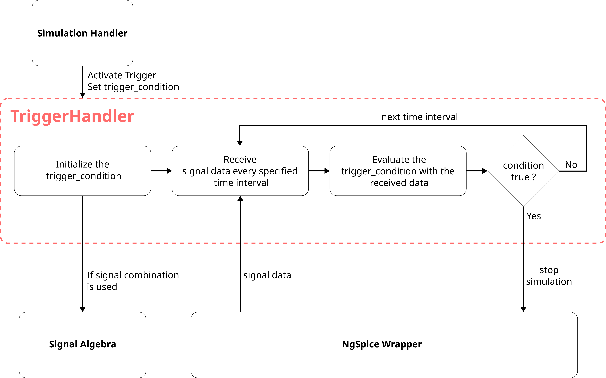

# **TriggerHandler: Software Design Document**

## **TriggerHandler: Software Design Overview**
The TriggerHandler module takes care of the `dynamic_stopping` of the simulation. It manages and defines the trigger conditions. Few types of standard conditions like exceeding a threshold, peak-to-peak steady state or any other functional conditions. The user shall use these definitions to provide the trigger conditions for a particular circuit configuration.

## **Description of the TriggerHandler**

The TriggerHandler module shall be realized in the form of a class that shall be used for initialization and activation of trigger related functionalities. This class will be responsible for receiving the data from ngspice_wrapper library, pass the data to the selected condition, detect when the condition is satisfied and call the stopping of the simulation. The trigger condition definitions shall be stored in a separate file and shall also be realized in the form of classes. The definitions shall contain the initialization of the conditions and shall also contain a function to evaluate these conditions. This evaluation function shall then be used by the TriggerHandler module to check if the condition is satisfied or not.

## **Trigger Condition Definitions Structure**

The trigger conditions shall be defined using a base class that specifies the common structure for all trigger conditions. Each type of trigger condition shall be implemented as a derived class of this base class.

The base class shall define an `evaluate()` function. Each derived class shall implement this function according to its specific condition. The function shall evaluate the simulation data and return `True` if the trigger condition is satisfied and `False` otherwise.

Two examples of trigger conditions are given below:

- **ThresholdTrigger:** Triggers when a signal satisfies a specified threshold condition.
  - **signal:** A string value that identifies the signal to be evaluated. It represents the left-hand side of the condition.
  - **operator:** A string value that defines the comparison operation, such as greater than (`>`), less than (`<`), greater than or equal to (`>=`), or less than or equal to (`<=`).
  - **threshold:** A float value that defines the reference value for the comparison. It represents the right-hand side of the condition.
  - **evaluate():** The function shall get the current value of the specified signal and compare it with the threshold using the specified operator. It shall return `True` when the condition is satisfied.

- **SteadyStateTrigger:** Triggers when a signal remains within a specified tolerance for a given number of samples.
  - **signal:** A string value that identifies the signal to be evaluated.
  - **tolerance:** A float value that defines the maximum allowed variation in the signal values.
  - **samples:** An integer value that defines the number of consecutive samples to be considered for the condition.
  - **evaluate():** The function shall evaluate the specified signal over the given number of samples and check whether its variation is within the specified tolerance. It shall return `True` when the condition is satisfied.

These trigger condition classes shall be defined in a dedicated file or module and can be used by the `TriggerHandler`.

New types of trigger conditions can be added by creating a new derived class from the base class and implementing its `evaluate()` function according to the required condition.

## **TriggerHandler Structure**

The `TriggerHandler` is the main class responsible for initializing and handling trigger conditions during a simulation.

The `SimulationHandler` provides the `trigger_condition` for a circuit configuration. If a trigger condition is provided, the `TriggerHandler` is initialized with the trigger condition and the `ngspice_wrapper` object. The `ngspice_wrapper` object is provided by the `SimulationHandler`, so the `TriggerHandler` does not need to create or maintain its own ngspice object.

The `TriggerHandler` receives simulation data from the `ngspice_wrapper` at the required time intervals. The signal required for evaluating the trigger condition is specified by the `trigger_condition`. The `TriggerHandler` requests or processes the required signal data from the `ngspice_wrapper`.

If the trigger condition contains a combination or expression involving multiple signals, the `SignalAlgebra` module shall be used to identify and process the required base signals and perform the required signal calculations.

Whenever new data is received, the `TriggerHandler` passes the relevant data to the `evaluate()` function of the trigger condition. If the condition is satisfied, the `TriggerHandler` calls the stop callback to request that the simulation be stopped.

The `SimulationHandler` remains responsible for the overall simulation process. After the simulation is stopped, it can detect the stop and continue with the next required configuration or perform the appropriate next step.

The `TriggerHandler` shall also ensure that the trigger condition and its required data are properly initialized before the simulation starts and that the trigger state is reset when a new simulation is started.

## **TriggerHandler SDD Diagram**

